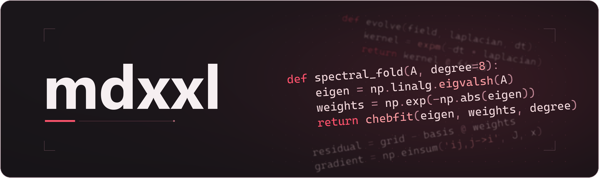

   &nbsp;
   &nbsp;
   &nbsp;
   &nbsp;
  

## Projects

### [Codex Chat Manager](https://github.com/mdxxl/CodexChatManager)

A native Windows app for browsing, searching, and cleaning up local Codex chat history.

`Rust` `Win32` `SQLite` · [Download for Windows](https://github.com/mdxxl/CodexChatManager/releases/latest/download/CodexChatManager.exe)

### [Warframe Market Price Undercutter](https://github.com/mdxxl/WarframeMarket-PriceUndercutter)

Keeps sell orders below matching offers on Warframe.market. `Python`

### [AutoFish for Majestic RP](https://github.com/mdxxl/AutoFish-MajesticRP-Bot)

Automates fishing using on-screen cues. `Python`
